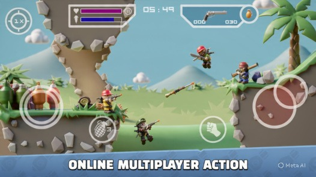

# Tiny Militia 3D (Web) 🎖️

A 3D / 2.5D web recreation of **Doodle Army 2: Mini Militia** built with **Three.js** and **Vite**.

Experience the classic intense combat with rocket boots, wave-based militia bot survival, dual touch joysticks or keyboard/mouse controls, and authentic sound effects.



---

## ✨ Features

- **3D Outpost Map**: Extruded 3D floating cliff islands, lush cartoon grass trims, 3D palm trees, bunkers, and background rolling hills generated from the original map geometry (`1outpost_new.tmx`).
- **Procedural 3D Characters**: Chibi soldier characters equipped with combat helmets / green berets, tactical goggles, tactical vests, twin-nozzle jetpacks, pivoting weapon-holding hands, and animated boots.
- **Wave Survival Mode**: Relentless waves of AI militia soldier bots that hunt you, fly across platforms with jetpacks, take cover, execute melee punches, and drop loot on death.
- **Arsenal of Weapons**:
  - **AK-47**: Rapid-fire assault rifle
  - **M16**: 3-round burst precision rifle
  - **Pump Shotgun**: Devastating multi-pellet spread
  - **Magnum .44**: High-caliber heavy revolver
  - **Desert Eagle**: Semi-auto tactical handgun
  - **M93BA Sniper Rifle**: Long-range bolt action with laser sight
  - **SMAW Rocket Launcher**: Propelled explosive missile with smoke trail
  - **Frag Grenades**: Bouncing explosive grenades with fuse timer
- **Authentic Audio**: Powered by Web Audio API using original sound effects (gunfire, jetpack thruster loops, ricochets, explosions, and Sarge voice callouts).
- **Responsive Controls**:
  - **Desktop**: Full Keyboard & Mouse support (WASD movement, Space/W boost, Mouse aim & shoot, G/Q grenade, F melee, R reload, E swap).
  - **Mobile / Touch**: Dual virtual joysticks (matching the original twin-stick overlay) and touch action buttons.

---

## 🚀 Quick Start

### Prerequisites
- [Node.js](https://nodejs.org/) (v18+)
- npm

### Installation & Run

```bash
# Clone the repository
git clone https://github.com/rayanfer32/tiny-militia-web.git
cd tiny-militia-web

# Install dependencies
npm install

# Start the development server
npm run dev
```

Open your browser at `http://localhost:5173/` and click **START MISSION**!

### Production Build

```bash
npm run build
npm run preview
```

---

## 🎮 Controls

| Action | Desktop Keyboard & Mouse | Mobile / Touch Screen |
| :--- | :--- | :--- |
| **Move Left / Right** | `A` / `D` or `Left` / `Right` Arrow | Left Virtual Joystick |
| **Jetpack Boost / Fly** | `W` / `Space` or `Up` Arrow | Left Virtual Joystick (Up) |
| **Aim & Shoot** | Mouse Cursor + Left Click | Right Virtual Joystick (Drag) |
| **Throw Grenade** | Right Click or `G` / `Q` | `Grenade` Icon Button |
| **Melee Strike** | `F` | `PUNCH` Button |
| **Reload** | `R` | `RELOAD` Button |
| **Swap / Pickup Weapon** | `E` | `SWAP` Button |

---

## 🛠️ Tech Stack

- **Game Engine**: [Three.js](https://threejs.org/)
- **Build Tool**: [Vite](https://vitejs.dev/)
- **Language**: Vanilla JavaScript (ES Modules), HTML5, CSS3
- **Audio**: Web Audio API (Polyphonic playback & spatial sound)
