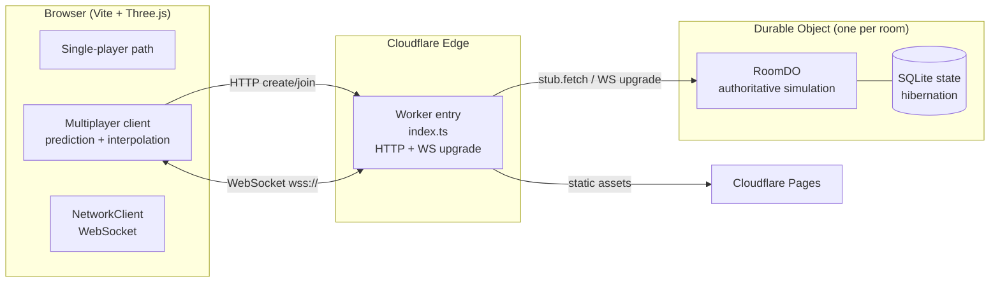
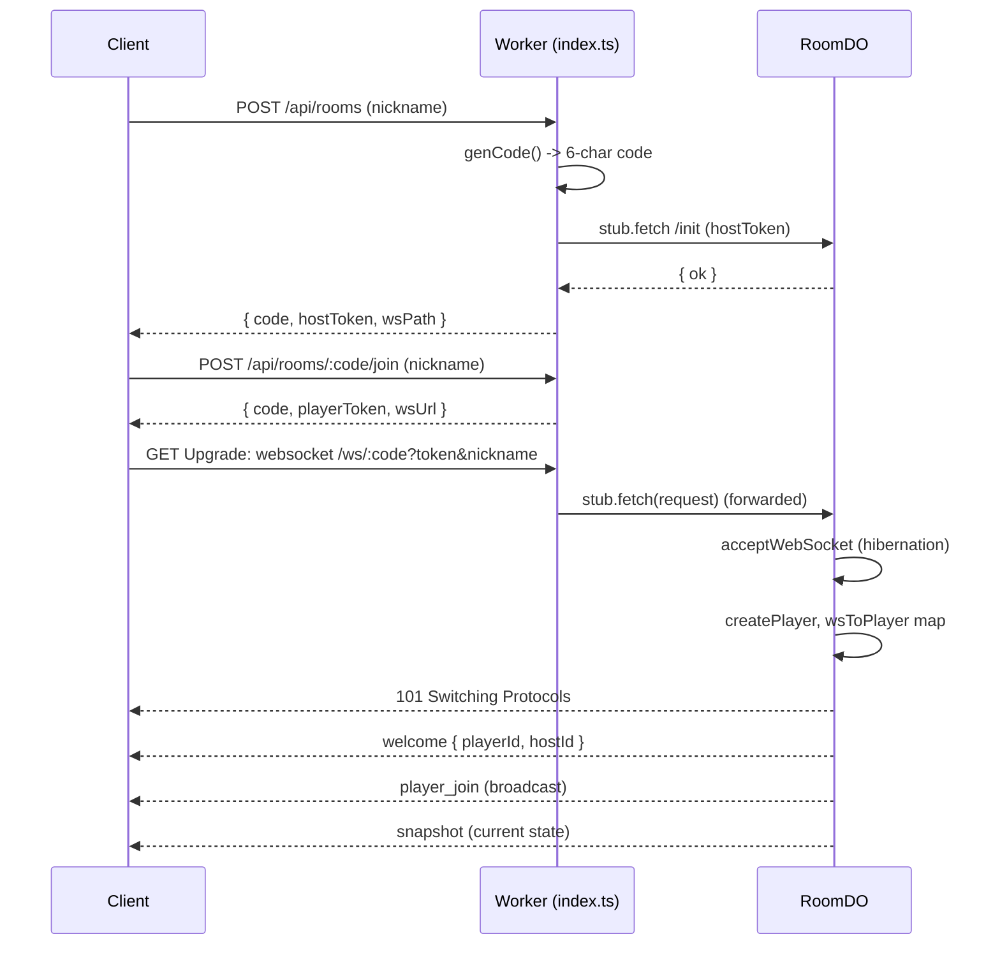
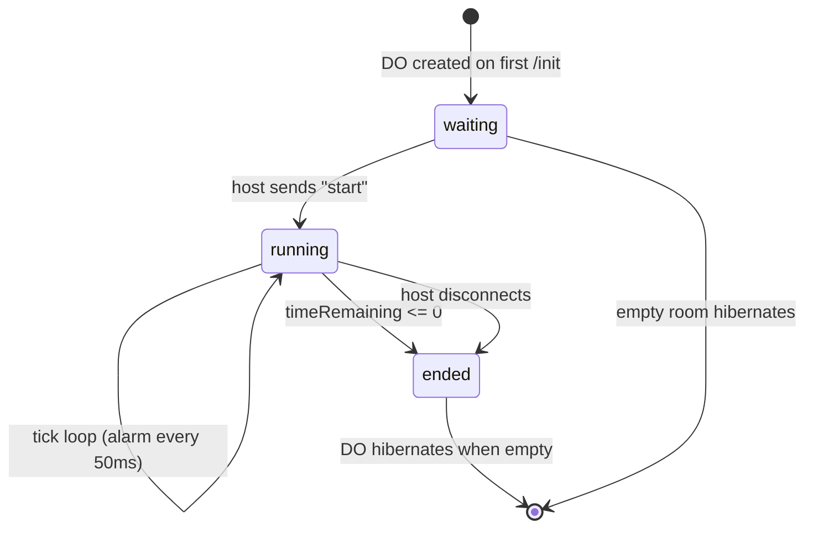
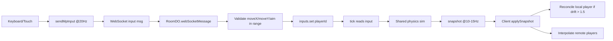
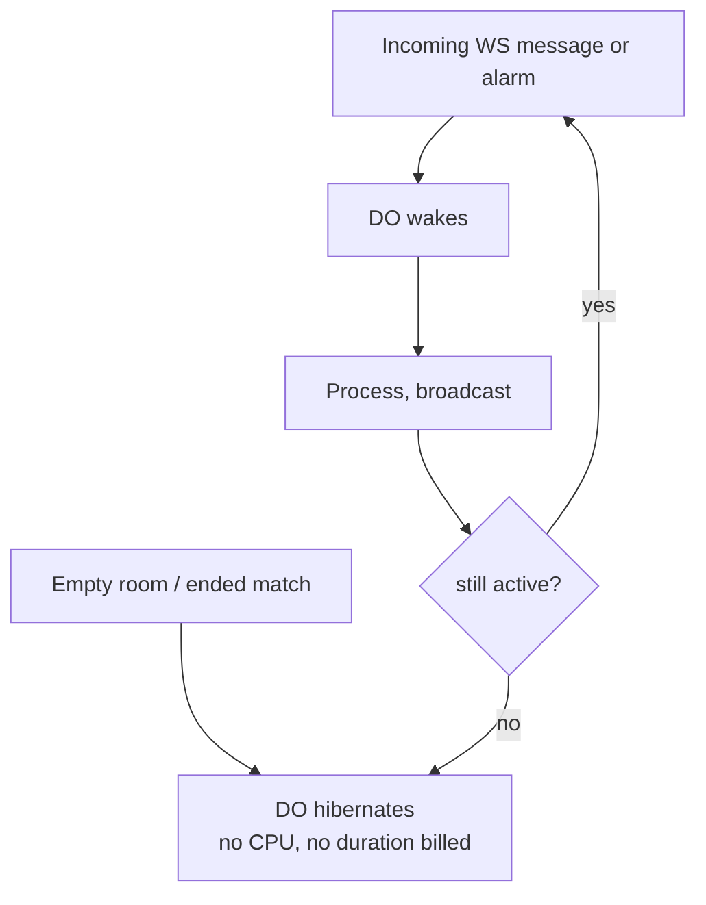

# Backend Architecture — Tiny Militia Multiplayer

Companion to `MULTIPLAYER_PLAN.md` and `CHECKPOINT.md`. Describes how the Cloudflare Worker + Durable Object backend works.

## 1. High-level architecture



## 2. Request & connection flow



## 3. RoomDO lifecycle (state machine)



## 4. Authoritative tick loop (20 Hz)

```mermaid
flowchart TD
  A[alarm() fires] --> B{status == running?}
  B -- no --> Z[stop scheduling, hibernate]
  B -- yes --> T[tick()]
  T --> P1[For each connected player]
  P1 --> I[Read latest input from inputs map]
  I --> HP[Health regen after 2.5s idle]
  HP --> BST[Jetpack consume/regen]
  BST --> RLD[Reload timer]
  RLD --> FIR{firing?}
  FIR -- yes --> HS[Hitscan raycast vs players<br/>apply damage, kill if health<=0]
  HS --> EV[broadcast shot/hit/kill events]
  FIR -- no --> MV
  EV --> MV[Movement integration<br/>slope tangent on ground / air physics]
  MV --> COL[resolveCircle vs map polygons/segments]
  COL --> ABY{y < -28?}
  ABY -- yes --> KILL[killPlayer (abyss)]
  ABY -- no --> NXT[next player]
  KILL --> NXT
  NXT --> P1
  P1 --> RSP[Respawn players whose timer elapsed]
  RSP --> TIM[Decrement match timer]
  TIM --> END{timeRemaining <= 0?}
  END -- yes --> EM[endMatch -> broadcast match_end]
  END -- no --> SNAP[broadcastSnapshot to all WS]
  SNAP --> SCH[scheduleTick -> setAlarm +50ms]
  SCH --> A
```

## 5. Data flow per player input



## 6. WebSocket message protocol

### Client -> Server
| type | payload |
|---|---|
| `input` | `{ seq, moveX, moveY, aimAngle, firing, boost, reload, weaponSlot? }` |
| `ready` | `{}` |
| `start` (host) | `{}` |
| `chat` | `{ text }` |

### Server -> Client
| type | payload |
|---|---|
| `welcome` | `{ playerId, hostId }` |
| `player_join` / `player_leave` | `{ playerId, nickname }` |
| `snapshot` | `{ tick, t, players[], match }` |
| `event` | `{ kind: shot\|hit\|kill\|respawn, ... }` |
| `match_start` | `{ duration }` |
| `match_end` | `{ scores[] }` |
| `chat` | `{ playerId, nickname, text }` |

## 7. Hibernation & cost model



- WebSocket connection setup counts as a request.
- Incoming WS messages bill at 20:1 ratio (100 msgs ≈ 5 requests).
- Alarms (20 Hz × 5 min) drive the tick loop only while `running`.
- Snapshots broadcast at 10–15 Hz to all connected clients.

## 8. Key files
| File | Role |
|---|---|
| `worker/index.ts` | Stateless glue: create/join room, WS upgrade, route to DO stub |
| `worker/RoomDO.ts` | Authoritative sim: players, inputs, tick loop, hitscan, health, death, respawn, timer, broadcast |
| `worker/data/outpost.json` | Map collision data (duplicate of `public/data/outpost.json`) |
| `shared/physics.ts` | Shared collision/physics (used by client + server) |
| `shared/weapons.ts` | Weapon definitions (client uses; server hardcodes subset) |
| `shared/types.ts` | Shared net/state types |
| `src/net/NetworkClient.ts` | Client WebSocket + HTTP API client |
